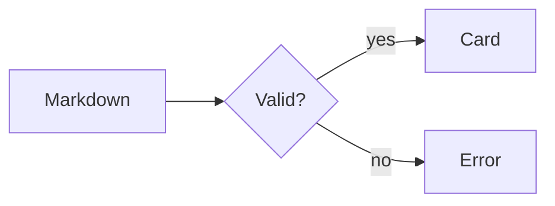

Paragraph before the first heading, for left-edge alignment. Body text with **bold**, *italic*, ~~strike~~, `inline code`, a [link](https://example.com) and a [relative link](gallery.md).

# Heading 1 in the gallery

Paragraph under H1.

## Heading 2 in the gallery

Paragraph under H2.

### Heading 3 in the gallery

Paragraph under H3.

#### Heading 4 in the gallery

Paragraph under H4.

##### Heading 5 in the gallery

Paragraph under H5.

###### Heading 6 in the gallery

Paragraph under H6.

## Rhythm paragraphs

Paragraph A, one of three plain paragraphs. The gap between A and B is the reference gap for every other block pair.

Paragraph B, the middle paragraph.

Paragraph C, the last plain paragraph.

## Lists

Paragraph before the bullet list.

- Bullet one
- Bullet two with enough text to wrap onto a second visual line when the window is narrow, so the hanging indent shows under the text and not under the marker
  - Nested bullet
    - Nested twice
- Bullet three

Paragraph between lists.

1. Ordered one
2. Ordered two
   1. Nested ordered
3. Ordered three

Paragraph before tasks.

- [ ] Task open
- [x] Task done
  - [ ] Nested task

Paragraph after the lists.

## Quotes and callouts

Paragraph before the quote.

> A blockquote with **bold** text that is long enough to wrap onto a second visual line when the window is narrow.

Paragraph before callouts.

::: info
Info callout with `code` and **bold**.
:::

::: warning
Warning callout.
:::

::: error
Error callout.
:::

::: success
Success callout.
:::

:::
Default callout with no type.
:::

::: custom Custom title
Custom callout type.
:::

Paragraph after callouts.

## Code

Paragraph before code.

```ts
// A TypeScript fence with a long line that should either wrap or scroll sideways depending on the word wrap setting, never both
export function add(a: number, b: number): number {
    return a + b;
}
```

```
Plain fence with no language.
```

Paragraph after code.

## Mermaid



```mermaid
flowchart LR
    A[Broken --> 
```

Paragraph after mermaid.

## Tables

Paragraph before the table.

| Left | Center | Right | Notes |
| :--- | :----: | ----: | ----- |
| Alpha | Beta | 1 | Short |
| Longer left text that wraps in a narrow window | Mid | 99.50 | A note with **bold** and `code` |
| Gamma | Delta | 100 | Last row |

Paragraph after the table.

## Rules and breaks

Paragraph before the rule.

---

Paragraph after the rule. This line ends with two spaces  
so this is a hard line break.

Averyveryveryveryveryveryveryveryveryveryveryveryveryveryveryveryveryverylongwordwithoutspaces and https://example.com/a/very/long/url/that/should/wrap/somewhere/instead/of/overflowing/the/content/column/of/the/editor

## Images


## Toggles

Paragraph above the toggles, for alignment.

<details open>
<summary>

## Toggle heading 2

</summary>

Body text under the H2 toggle.

- bullet inside
- second bullet

| A | B |
| - | - |
| 1 | 2 |

<details open>
<summary>

### Nested H3 toggle

</summary>

Nested body.

</details>

</details>

<details>
<summary>

Closed plain toggle

</summary>

Hidden body.

</details>

Paragraph below the toggles.

## Footnotes and definitions

A footnote reference[^1].

[^1]: The footnote text.

Term
: Definition (not standard GFM, shows as text).

## End

Last paragraph of the gallery.
